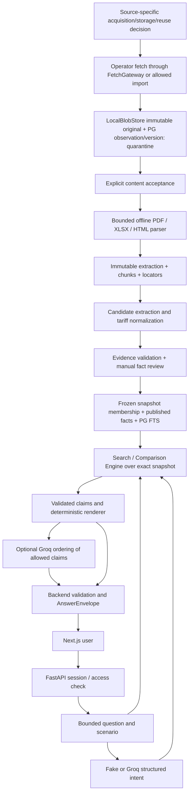

# Snapshot v1: модульный монолит

## Продукт и границы

AI-ассистент отвечает на вопросы об условиях и сравнивает зарплатные проекты
`sber`, `vtb`, `alfa`, `kuban_credit` в выбранном регионе, сегменте и сценарии.
Ответ относится к явно выбранной frozen corpus revision и дате условий. Он не
обещает актуальность сайта банка сегодня и не заменяет индивидуальное предложение.
В v1 входят первоначальный policy-gated fetch или разрешённый manual import,
PDF/XLSX/HTML parsing, extraction/normalization/review, поиск, Comparison Engine,
Groq/Fake LLM, FastAPI, авторизация/сессии и Next.js.

Вне v1: scheduler, периодический fetch, change detection, notifications, outbox,
отдельные workers/services, Redis/Celery, vector DB/pgvector, browser automation,
OCR, multi-agent runtime, публичная регистрация, загрузка зарплатных реестров,
постоянная память чата и email delivery. Новая версия корпуса создаётся вручную
как отдельная revision; принятую revision не изменять.

## Стек и минимальное развёртывание

| Слой | Выбор |
|---|---|
| Backend | Python 3.11, FastAPI, Pydantic v2, SQLAlchemy, psycopg, Alembic |
| DB | PostgreSQL 18, обычный SQL и FTS/GIN |
| Originals | Существующий LocalBlobStore, локальный persistent volume, SHA-256 |
| Parsers (план) | pdfplumber/pdfminer.six, openpyxl, stdlib HTMLParser за общим Protocol |
| LLM (план) | Groq OpenAI-compatible API, `openai/gpt-oss-120b`; Fake — тот же Protocol |
| UI | Next.js 16, React 19, TypeScript; существующий frontend |
| Dev/CI | uv/npm lockfiles, Docker Compose DB/backend, pytest/ruff/mypy, ESLint/tsc |

Один FastAPI process и один Next.js process, один PostgreSQL и один blob volume.
Для HTTPS можно использовать существующий ingress платформы; dedicated gateway
service не нужен. Начальный deployment — один API instance: bounded semaphore и
in-process short-window лимиты достаточно просты; дневной provider budget и
auth sessions хранятся в PostgreSQL. Клиент ходит на API через same-origin proxy.
Groq key существует только на backend.

Parser dependencies добавляются в SNAP-04/05; их нет в текущем lockfile.
PyMuPDF не вводить автоматически: прежнее лицензионное решение не завершено.
Parser subprocess с ограничениями ресурсов — локальная изоляция, не микросервис.
Ручной CLI выполняет pipeline последовательно; HTTP не запускает большие импорты.

## Потоки данных

Content acceptance не публикует тариф. LLM не вычисляет стоимость и не решает,
что документ одобрен. Поиск возвращает только members выбранного snapshot с
допущенными данными. Original доступен через authenticated attachment route.

## Существующее и планируемое

Сохранить без переписывания `ingestion/{gateway,transport,tls,robots,policy,service,
formats,adapters,evidence,cli}.py`, `storage/local.py`, registry, E2E и миграции.
`formats.py` проверяет контейнер, а не извлекает содержание; `adapters.py` делает
discovery для ВТБ/Кубань Кредит, а не четыре полноценных парсера тарифов.
Queue helper/JobRun ORM, worker lease/heartbeat config и 72h stale logic удалены.
`IngestionService.current_content()` возвращает ID последней accepted version
для операторской инспекции; это не snapshot membership и не проверка прав чтения.
Новый snapshot read service проверяет точное membership, rights revocation, hashes
и business validity. Старые physical DB audit objects не удаляются; active ORM
их не использует, Alembic исключает только явно перечисленные retired objects.
Миграция 0003 задаёт инертный DB default старому NOT NULL schedule column, чтобы
новые source rows создавались без scheduling fields. FETCH_MAX_ATTEMPTS и retry_at
ограничивают явные operator attempts, не запускают фоновые повторы. `/health` — liveness, не product readiness.

Дальнейшие модули: `contracts`, `parsing`, `corpus`, `tariffs`, `evidence`, `search`,
`comparison`, `llm`, `assistant`, `auth`, `api`; это директории внутри `backend/app`.
API, auth и UI можно разрабатывать на synthetic fixtures до допуска корпуса.
Реальный четырёхбанковский release требует отдельной snapshot-приёмки.
