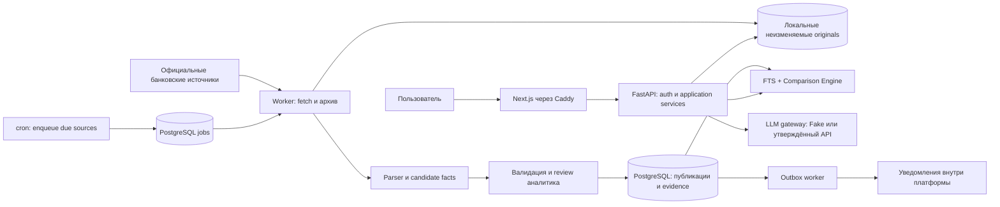

# Архитектура v1.1 — спецификация для согласования

## Границы

Один продукт и один Python backend с модулями. Отдельные процессы `api`, `worker`, `scheduler` используют один backend image и одну БД. UI — Next.js. В MVP один Linux host в РФ, Docker Compose, Caddy как предложенный reverse proxy. Все эти процессы — способы запуска монолита, не отдельные распределённые сервисы.

Базовый стек пользователя сохранён. Добавления: SQLAlchemy 2 + psycopg для доступа к PostgreSQL, Alembic для миграций, Pydantic для контрактов; pytest и Playwright для проверки, Argon2id для паролей. Точные версии фиксировать в lockfiles INF-001 после проверки совместимости и лицензий. PyMuPDF требует отдельного лицензионного решения; при его отсутствии proposed baseline — pdfplumber за общим Parser interface. Обоснования и внешние ссылки: [SOURCES](../research/SOURCES.md).

## Инварианты

- I-01: любой опубликованный fact имеет минимум один evidence fragment и доступный immutable оригинал.
- I-02: денежные вычисления Decimal, без float; ставки хранятся в процентных пунктах, в формуле делятся на 100 ровно один раз.
- I-03: latest fetched ≠ current effective; неизвестная дата не заменяется датой скачивания.
- I-04: отсутствие данных ≠ нулевая стоимость ≠ отсутствие услуги.
- I-05: сравнение фиксирует одинаковые scenario, date, currency, payer, operation и критерий.
- I-06: факт из истории чата никогда не источник текущего ответа.
- I-07: ссылки и номера страниц создаёт backend из evidence; LLM их не вводит.
- I-08: повтор job, review или HTTP message с тем же ключом не дублирует результат.
- I-09: каталог банков общедоступен только аутентифицированным сотрудникам; чаты персональны.
- I-10: ошибки источника и parser не удаляют last known good; UI показывает давность.
- I-11: partial parsing не подтверждает отсутствие/отмену условий.
- I-12: новая публикация атомарно меняет видимый corpus revision; ответ сохраняет использованные IDs.

## POC и MVP

POC: локальный профиль только на loopback, четыре банка, действительные архивированные документы, extraction/search/comparison, Fake LLM, минимальный экран вопроса. Самый ранний gate — достаточность источников; затем доказательность и повторяемость. Открытая сеть и реальные сотрудники в POC запрещены конфигурацией.

MVP: invite auth, роли, защищённые API, чат с persisted context, восемь разделов UI, фоновые проверки, review, уведомления внутри сайта, backup/restore, нагрузочные и security проверки. Real LLM — отдельная ветвь после выбора пользователем. С Fake можно принять технический MVP, но не заявлять проверенное качество реального AI.

Не входят: банковские операции, загрузка зарплатных реестров и ПД сотрудников, подбор кредитов, обход CAPTCHA, OCR production, чат-агенты с записью, cross-tenant договоры, внешние email/SMS уведомления, отдельный vector store. Для индивидуальных тарифов MVP хранит публичный факт «по договору», без выдуманного значения. Безопасное добавление приватных документов требует отдельного ADR и ACL.

## Предположения и владельцы решений

| Решение | Предложенный вариант | Кто утверждает / когда |
|---|---|---|
| Сегмент начального корпуса | Малый/средний бизнес; крупные и premium отдельно маркируются | Пользователь, gate G0 |
| Базовый регион | RU-KDA, федеральные правила только с подтверждённой применимостью | Пользователь, G0 |
| Хостинг и ПД | Один защищённый host в РФ, backup также в РФ | Владелец инфраструктуры и ответственный по ПД, до MVP |
| Частота источников | 24 часа, jitter ±30 мин | Admin, после source policy review |
| LLM модель и API | Не выбраны; Fake по умолчанию | Только пользователь |
| Хранение чатов | До удаления, максимум 180 дней по proposed policy | Пользователь/оператор до запуска |
| RPO/RTO | 24 ч / 4 ч | Пользователь до OPS-002 |
| Лицензия PDF | Проверить PyMuPDF; fallback pdfplumber | Владелец продукта до PDF-001 |

Параметры — проектные цели, не замеренные свойства и не юридическое заключение. Согласование не блокирует подготовку документации, но необходимые gates явно блокируют соответствующую реализацию/публикацию.
