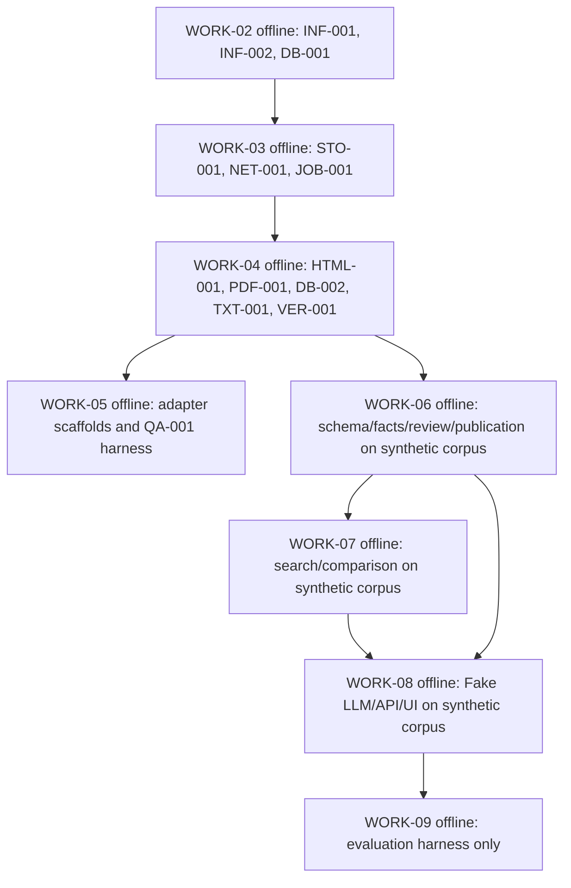

# Dependency graph and execution modes

Top-level `deps` in WORK_INDEX describe full WORK acceptance. `offline_checkpoint.deps` describe only the admitted offline checkpoint. A completed checkpoint does not complete the WORK block or satisfy G1/G2. All original task IDs remain in TASK_INDEX.

## Offline graph (G0-OFFLINE)

Each checkpoint requires G0-OFFLINE. Offline/test/CI has no external ingestion requests, including redirects, subresources, parser, or browser renderer. Fake transport is allowed. Preserve full acceptance dependencies, except WORK-01 is removed from WORK-02; offline graph alone does not complete any WORK block.

## Live and acceptance graph

```mermaid
flowchart LR
  SRC[SRC-001: per-source policy decision] --> LIVE[G0-LIVE exact host/path]
  LIVE --> FETCH[Allowed retrieval]
  FETCH --> CONTENT[Content acceptance and immutable evidence]
  CONTENT --> ING[WORK-05 real adapter checks]
  ING --> G1[G1: all 4 banks, 3 distinct days within 1 week]
  G1 --> FACT[WORK-06 real-corpus validation/publication]
  FACT --> POC[WORK-07/08 real-corpus checks]
  POC --> G2[WORK-09 G2 report and user acceptance]
  G2 --> LATER[WORK-10 through WORK-19]
```

G0-LIVE is per source and is not approved for any bank source as of 2026-10-10. G1 requires an approved source and scheduled-fetch evidence for all four banks on at least three different days within one week. Manual import does not count. G2 requires real documents, human-reviewed gold/tune/holdout, and all original thresholds. Reports or checkpoints cannot self-accept G1/G2; user acceptance is required.

WORK-16 is not a prerequisite for source retrieval: SRC-001 records the source-specific decision on acquisition, storage, and reuse before bytes are fetched. WORK-16 remains the broader production legal/privacy/retention review and gates production capabilities.

[WORK_INDEX](WORK_INDEX.json) | [TASK_INDEX](TASK_INDEX.json) | [ADR-006](../architecture/ADR/006-g0-offline-and-live-ingestion.md)
