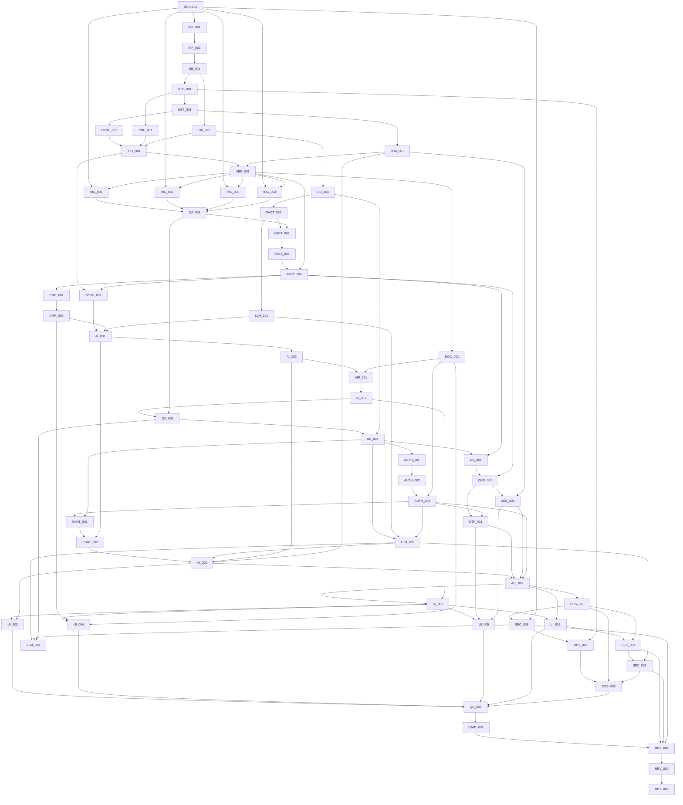

> Детализация исходных 62 этапов. Актуальные единицы исполнения — 22 WORK-блока в [MASTER_PLAN](MASTER_PLAN.md). Исходные ID сохранены для трассировки требований. Старый порядок использовать только как справку; уровни reasoning см. в обновлённых ТЗ.

# Граф зависимостей

Граф соответствует TASK_INDEX.json; технические циклы запрещены. Это зависимости результатов, а не обещание параллельной работы агентов. По умолчанию Luna исполняет последовательно.

G0 предшествует всем задачам. G1 принимается по QA-001, G2 по QA-002; B* задачи требуют G2. G3/G4 предшествуют независимому аудиту. LLM-003 — отдельная ветвь с внешним решением пользователя; для real AI release её результат становится обязательным входом REV-001.

Потенциально независимы: HTML-001/PDF-001/DB-002, четыре adapters после VER-001, UI-003/004/005/006 после готовых API. Однако shared DTO, migrations и общий pipeline меняются последовательно. Новый migration file всегда согласует single head; нельзя параллельно генерировать конкурирующие ревизии без интеграции.

Критическая цепочка: source feasibility → archive/fetch → parsing/versioning → 4 adapters/G1 → evidence facts/publication → deterministic comparison → POC/G2 → auth/chats/events/API → E2E/security/restore/load → independent review/fixes/retest.
