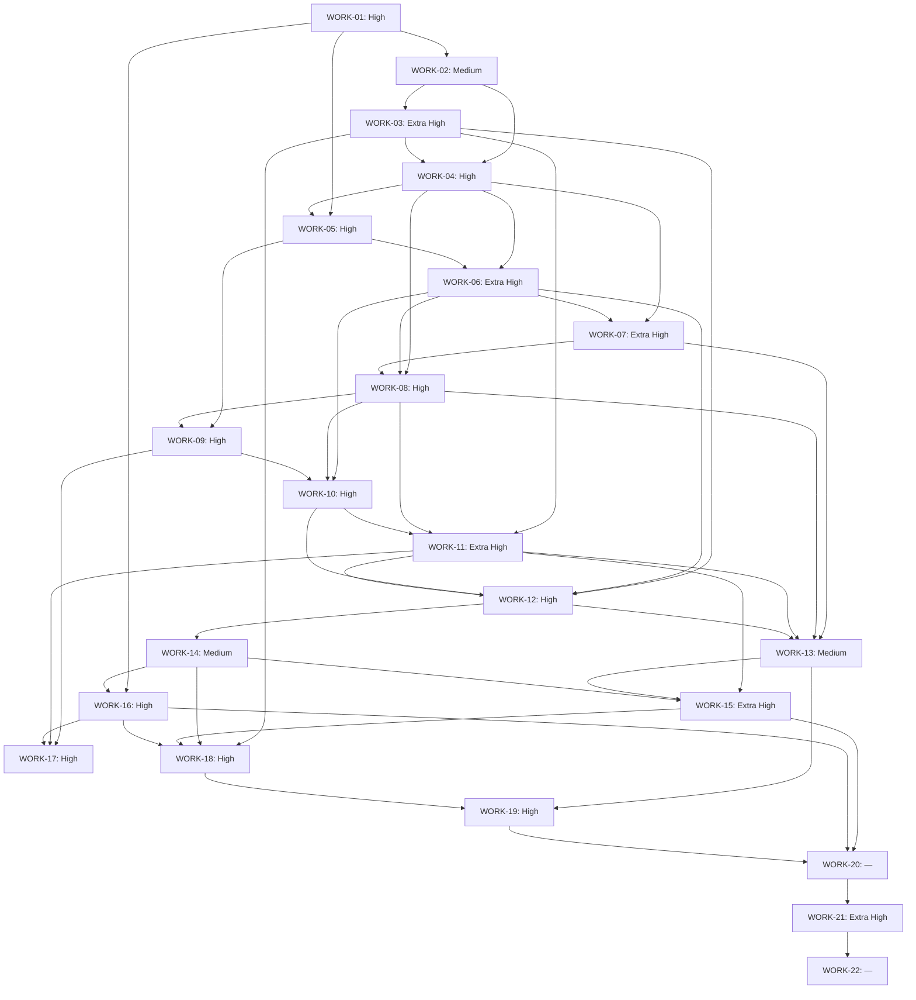

# Зависимости объединённых блоков

Рёбра вычислены из зависимостей всех исходных этапов. Каждый старый ID входит ровно в один WORK. Внутри блоков сохранён топологический порядок.

G0 обязателен перед разработкой; G1 после WORK-05, G2 после WORK-09. WORK-17 дополнительно зависит от решения пользователя о provider; для реального AI его успешная evaluation обязательна перед WORK-20. С Fake этот блок можно оставить BLOCKED с явным ограничением release.

[Внутренняя детализация графа](DETAILED_DEPENDENCIES.md), [правила reasoning](REASONING_GUIDE.md).
